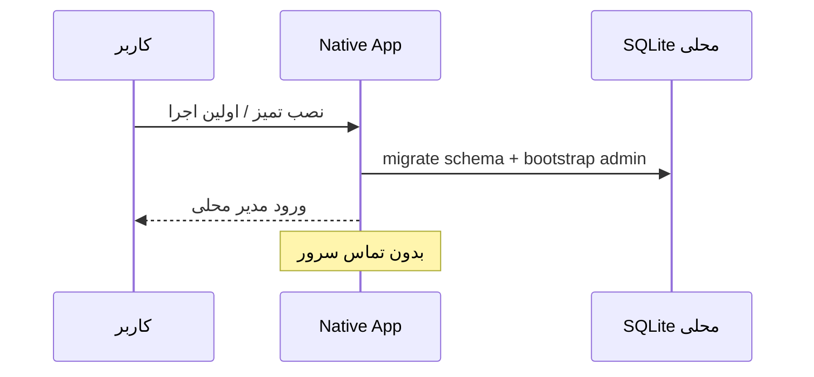
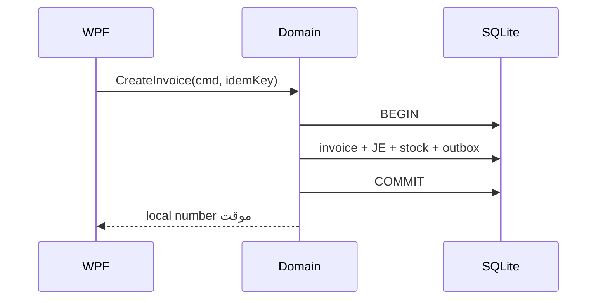
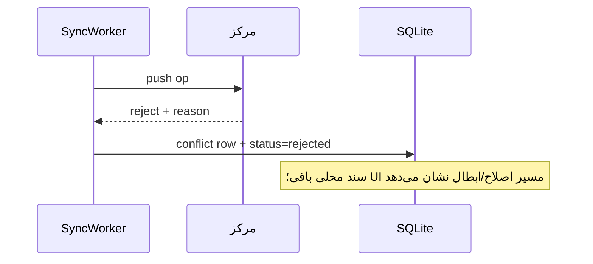

# معماری محصول بومی ویندوز — ERP ترنم (Native Desktop v1)

> وضعیت: **سند معماری قابل‌اجرا** (نه بیلد/نه مهاجرت اجراشده)  
> تاریخ پیش‌نویس: ۱۴۰۵/۰۷/۰۵ · منبع دستور: مأموریت «اصلاح قطعی مأموریت نسخهٔ دسکتاپ»  
> اولویت این سند بر معماری فعلی Electron (`desktop/` + loopback Web UI) است.  
> نسخهٔ Electron موجود تا آماده‌شدن مسیر مهاجرت **حفظ** می‌شود؛ محصول نهایی آن نیست.

---

## ۰) حکم معماری (یک پاراگراف)

محصول هدف یک **اپلیکیشن بومی Windows (WPF روی .NET 8)** با **موتور دامنهٔ محلی تراکنشی**، **SQLite متعلق به نصب**، **احراز هویت محلی**، **گزارش/چاپ محلی**، و دو کارگر پس‌زمینهٔ جدا (`SyncWorker` و `UpdateWorker`) است. رابط اصلی **نه Electron، نه WebView، نه PWA، نه سایت مرکز، نه سایت localhost** است. منطق فعلی Node در فاز اول به‌صورت **Domain Host بدون UI** (فرایند محلی، Named Pipe / gRPC) برای حفظ برابری محاسبات قابل استفادهٔ مجدد است؛ هر ماژول پس از عبور از **آزمون تطبیقی طلایی** می‌تواند به C# منتقل شود. وابستگی شبکه فقط برای (الف) همگام‌سازی کسب‌وکار با مرکز و (ب) دریافت بستهٔ به‌روزرسانی است و قطع آن‌ها نباید اجرای محلی را متوقف کند.

---

## ۱) اهداف، غیر اهداف، فرضیات، قیود، معیار موفقیت

### ۱.۱ اهداف
- برابری امکانات و نتیجهٔ کسب‌وکار با نسخهٔ سرور فعلی برای همهٔ ماژول‌های واقعی موجود.
- استقلال اجرایی کامل آفلاین (پذیرش فقط با آزمون قطع کامل مسیر به مرکز — نه فقط Wi-Fi).
- حفظ قرارداد سینک با مرکز و اندروید (بازپخش عملیات، نه ادغام ردیف).
- نصب‌کنندهٔ واقعی، updater امضاشده، backup/recovery محلی، مهاجرت از Electron.

### ۱.۲ غیر اهداف (این نسخه)
- بازنویسی اندروید به UI بومی (قرارداد سینک ثابت می‌ماند).
- انتشار Store / MSIX اجباری (اختیاری بعدی).
- چندکاربره هم‌زمان روی یک فایل DB شبکه‌ای.
- اتصال مستقیم به فایل SQLite سرور یا DB مرکزی از دسکتاپ.
- VAT/مالیات قانونی جدید فراتر از آنچه سرور امروز دارد.

### ۱.۳ فرضیات (برچسب‌دار)
| شناسه | فرض | نیاز به تأیید؟ |
|---|---|---|
| A1 | کاربران هدف: Windows 10/11 x64 دفتر/نماینده؛ arm64 خارج از محدودهٔ v1 | خیر |
| A2 | توزیع خارج از Microsoft Store؛ میزبان HTTPS ایرانی برای installer | **بله** (میزبان) |
| A3 | گواهی Authenticode OV در دسترس می‌شود | **بله** |
| A4 | لایسنس فعلی (`server/lib/license/*`، Ed25519 آفلاین) پایهٔ سیاست دسکتاپ است | خیر (کد موجود) |
| A5 | تیم می‌تواند WPF + نگهداری موقت Node Domain Host را بپذیرد | **بله** |
| A6 | مقیاس تک‌کاربره/نصب محلی؛ سرویس SQL جدا لازم نیست | خیر |

### ۱.۴ قیود قطعی (از مأموریت مالک)
- ممنوع: Electron / WebView به‌عنوان UI اصلی، PWA، بازکردن سایت سرور، localhost-as-product.
- ممنوع: LWW برای تعارض مالی؛ ممنوع overwrite کامل DB محلی از سرور.
- رد عملیات در مرکز نباید سند محلی را بی‌صدا حذف کند.
- نصب تمیز باید بدون سرور، محیط محلی + مدیر محلی بسازد.
- دادهٔ دریافت‌نشده موجود فرض نشود.

### ۱.۵ معیارهای موفقیت قابل اندازه‌گیری
1. **آزمون هواپیما (Air-gap):** پس از seed، مسدودسازی همهٔ مسیرهای مرکز/اینترنت + reboot Windows → ورود، CRUD مشتری/کالا، خرید/فروش، مالی/انبار، گزارش، چاپ، backup/restore، بستن/بازکردن — همه موفق؛ سپس reconnect و سینک بدون گم‌شدن/ثبت دوباره/تخریب دفتر.
2. **ماتریس تطبیق:** ۱۰۰٪ ماژول‌های سرور در وضعیت `done` یا `deferred-with-owner-signoff`.
3. **پاریتی محاسباتی:** مجموعهٔ fixture طلایی (حداقل مسیر مشتری←سفارش←فاکتور←JE←موجودی) روی سرور و دسکتاپ نتیجهٔ یکسان (مبالغ، تراز، موجودی).
4. **قطع Sync/Update:** با خاموش‌کردن workerها برنامه سالم بماند.
5. **Installer:** NSIS/Inno Setup امضاشده؛ به‌روزرسانی بدون electron-updater.

---

## ۲) زمینه سیستم (C4 L1)

```
┌─────────────┐     UI بومی WPF      ┌──────────────────────────────────────┐
│ کاربر محلی  │ ───────────────────▶ │  ERP Taranom Native.exe              │
└─────────────┘                      │  ├─ Presentation (WPF RTL)           │
                                     │  ├─ Application Services             │
                                     │  ├─ Domain (C# و/یا Node Host)       │
                                     │  ├─ SQLite محلی + فایل‌ها            │
                                     │  ├─ Local Auth / Settings / Audit    │
                                     │  ├─ SyncWorker (اختیاری شبکه)        │
                                     │  └─ UpdateWorker (اختیاری شبکه)      │
                                     └───────────────┬──────────────────────┘
                         فقط وقتی آنلاین             │
                    ┌────────────────────────────────┼────────────────┐
                    ▼                                ▼                │
           ┌────────────────┐              ┌──────────────────┐       │
           │ مرکز ایران     │              │ میزبان Update    │       │
           │ sync push/pull │              │ (HTTPS+امضا)     │       │
           └────────────────┘              └──────────────────┘       │
                    ▲                                                    │
                    │ همان قرارداد سینک                                  │
           ┌────────────────┐                                            │
           │ Android device │ (nodejs-mobile؛ خارج از این محصول)         │
           └────────────────┘                                            │
```

**مرز اعتماد:** هر چیزی داخل نصب محلی = اعتماد به کاربر ویندوز آن ماشین. مرکز = منبع حقیقت سازمانی برای داده‌های پذیرفته‌شده. SyncWorker هویت دستگاه + کاربر سازمانی را حمل می‌کند؛ Local Admin اختیار مرکز ندارد.

---

## ۳) فاصله با واقعیت امروز (شکاف محصول)

| واقعیت کد فعلی | حکم مأموریت جدید |
|---|---|
| `desktop/` = Electron + `loadURL(http://127.0.0.1)` + UI وب | **رد** به‌عنوان محصول نهایی |
| منطق = همان `server/` embedded | قابل استفاده به‌عنوان Domain Host **بدون UI وب** |
| `centralOnly` بسیاری از admin را روی device ممنوع می‌کند | برای دسکتاپ بومی باید **مدیر محلی** جدا تعریف شود |
| updater = electron-updater | باید جایگزین شود (Velopack / سفارشی) |
| Handoff هنوز «ویندوز = Electron» می‌گوید | این سند جایگزین مسیر محصول است |

---

## ۴) انتخاب فناوری (ADR-NWD-001)

### ۴.۱ گزینه‌های بررسی‌شده (خلاصه)

| گزینه | RTL/فارسی | گرید مالی | چاپ/PDF/Excel | SQLite | Update/Install | استفاده مجدد JS | نگهداری |
|---|---|---|---|---|---|---|---|
| WinUI 3 | متوسط | DataGrid ضعیف‌تر از WPF | متوسط | خوب | خوب | نه مستقیم | خوب؛ اکوسیستم نوظهورتر |
| **WPF .NET 8** | **قوی** | **عالی** | **عالی** | عالی | NSIS+Velopack | با Host | **بلندمدت مایکروسافت** |
| Avalonia | خوب | خوب | متوسط | خوب | خوب | نه | تیم کوچک‌تر |
| Qt 6 | عالی | خوب | خوب | خوب | پیچیده | نه | C++/هزینه |
| Delphi VCL | سنتی قوی در ایران | قوی | قوی | خوب | خوب | نه | لایسنس تجاری + قفل فروشنده |
| Hybrid Native+Node Host | — | — | — | — | — | **حداکثر** | دو runtime |
| Full C# rewrite | — | — | — | — | — | صفر اولیه | تمیزتر بعد از پاریتی |

### ۴.۲ تصمیم

**اولیه (Primary):**  
`.NET 8 + WPF` برای UI + لایه‌های Application/Infrastructure، به‌همراه **Domain Host فازبندی‌شده**:

1. **Wave 0–1:** Domain Host = استخراج فراخوانی‌های دامنه از `server/` بدون سرو کردن `public/`؛ ارتباط فقط Named Pipe (یا gRPC روی pipe). هیچ BrowserWindow / WebView2 برای محصول اصلی.
2. **Wave 2+:** انتقال تدریجی Aggregateها به `Taranom.Domain` (C#) با **Golden Parity Tests** در برابر fixtureهای Node.

**Fallback:** اگر نگهداری دو runtime غیرقابل‌قبول شد → توقف Host و **Full C# Domain** از روی همان fixtureها قبل از گسترش ماژول‌ها.

**رد صریح:** Electron، WebView2 به‌عنوان پوستهٔ اصلی، PWA، MAUI به‌عنوان UI اصلی v1 (ریسک گرید/چاپ).

### ۴.۳ استفادهٔ امن از منطق JS
- مجاز: محاسبات، پست سند، اعتبارسنجی، سینک capture در Host محلی.
- ممنوع: رندر HTML محصول؛ fetch به مرکز از UI؛ بازکردن URL سرور؛ HTTP/localhost به‌عنوان کانال UI.
- قرارداد Host: `Invoke(command, payload, idempotencyKey) → Result` داخل تراکنش محلی؛ UI فقط DTO می‌بیند.
- **قیدهای اجباری Host (از ADR ارزیابی موازی):**
  1. فقط Domain Host مالک SQLite و تراکنش‌هاست؛ WPF مستقیم DB را نمی‌نویسد.
  2. کانال = **Named Pipe با ACL کاربر جاری** (نه HTTP، نه `127.0.0.1` برای UI).
  3. قرارداد IPC نسخه‌دار، typed، با سقف اندازه و timeout/cancellation.
  4. Host فقط توسط Parent Process spawn می‌شود؛ Watchdog + crash recovery + graceful shutdown.
  5. استخراج Application Service از Express تا IPC دسکتاپ و API مرکز از یک منطق مشترک تغذیه شوند (پل موقت IPC→Express فقط تا استخراج کامل مجاز است).
  6. معیار خروج از Node per-module: golden parity + shadow comparison + پایداری عملیاتی.

---

## ۵) نقشهٔ قابلیت / ماژول و مالکیت

### ۵.۱ کانتینرها

| کانتینر | مسئولیت | فناوری |
|---|---|---|
| `Taranom.Desktop` | Shell، ناوبری RTL، DPI، میانبر، چاپ UI | WPF |
| `Taranom.Application` | Use-caseها، مجوز، واحدکار | .NET |
| `Taranom.Domain` / `DomainHost` | قواعد کسب‌وکار، JE، موجودی | C# و/یا Node |
| `Taranom.Infrastructure` | SQLite، فایل، backup، DPAPI | .NET + SQLite |
| `Taranom.SyncWorker` | outbox/push/pull/conflicts/files | سازگار با `docs/OFFLINE-SYNC.md` |
| `Taranom.UpdateWorker` | بررسی/دانلود/تأیید امضا/نصب امن | Velopack یا معادل |
| مرکز (`server/`) | حقیقت سازمانی + بازپخش | بدون تغییر قرارداد عمومی |

### ۵.۲ ماتریس تطبیق (استخوان‌بندی — تکمیل با inventory کامل)

**پایهٔ موجود (Electron/device):** `docs/DESKTOP-OFFLINE-MODULE-MATRIX.md` — پوشش آفلاین فعلی با `SYNC_ROLE=device` و محدودیت‌های `centralOnly`/`centralOnlyStrict`.

**شکاف اجباری نسبت به مأموریت بومی (باید در ماتریس جدید حل شود):**
- نصب تمیز + **مدیر محلی** بدون سرور (امروز pairing/کاربران سازمانی پررنگ‌ترند).
- **Backup/restore محلی** روی دسکتاپ بومی (امروز `centralOnlyStrict` بکاپ ادمین را فقط مرکز می‌داند).
- UI بومی جایگزین وب؛ ماتریس باید ستون «معادل بومی WPF» بگیرد نه «همان index.html».
- آزمون پذیرش = air-gap کامل، نه فقط offline Wi-Fi.

وضعیت‌ها: `todo` | `slice` | `parity` | `done` | `central-external` | `local-admin-new` | `policy-change`

| قابلیت سرور | گردش کار | معادل بومی | دادهٔ محلی | آزمون تطبیق | وضعیت |
|---|---|---|---|---|---|
| Auth ورود | login/logout/session | LocalAuth + LocalUsers | `users`, sessions | air-gap login | todo |
| مدیر محلی نصب تمیز | bootstrap admin | FirstRunWizard | local users | clean install offline | **local-admin-new** |
| کاربران سازمانی | CRUD users (مرکز) | pull + اختیارات محدود | users synced | conflict password | todo |
| CRM مشتری | CRUD مشتری | Customers module | customers, parties | create/edit offline | slice |
| پیگیری | followups | Followups | followups | CRUD | todo |
| سفارش | order lifecycle | Orders | orders, lines | order→invoice | slice |
| فاکتور فروش | proforma/final/cancel R13 | Invoices | invoices, JE, stock | parity amounts | slice |
| خرید | PO/invoice/return | Purchases | purchase_* | JE+stock | todo |
| حسابداری JE | سند دستی/برگشت | Journals | journal_* | trial balance | todo |
| خزانه بانک/صندوق | transfer/recon | Treasury | banks, cash | transfer | todo |
| چک | recv/pay/trust | Cheques | cheque_* | status machine | todo |
| انبار | move/stocktake/reserve | Inventory | warehouse_*, stock | move+kardex | todo |
| تولید | BOM/order/exec | Production | production_* | smoke | todo |
| حقوق | payroll periods | Payroll | payroll_* | period | todo |
| گزارش‌ها | TB/BS/PL/adv | Reports local | read models | compare server | todo |
| چاپ/PDF/Excel | print invoice | Local print stack | — | print offline | slice |
| تنظیمات محلی | prefs نصب | LocalSettings | settings local | offline | local-admin-new |
| تنظیمات سازمانی | modules/flags | pull-only یا conflict UI | settings synced | central reject | todo |
| Backup/Restore | encrypted backup | BackupService | backups/ | restore+outbox | todo |
| Sync | push/pull | SyncWorker | outbox, conflicts | test-sync compat | todo |
| Update | feed+install | UpdateWorker | pending pkgs | signed update | todo |
| SMS | send | Outbox external | sms queue | queue while offline | central-external |
| License | Ed25519 offline | LicenseService | license rows | offline grace | todo |
| API keys / cron مرکز | — | N/A on desktop | — | — | central-external |
| B2B portal | — | خارج یا read-only | — | — | deferred |
| AI assistant | optional | disable offline | — | — | central-external |

> تکمیل ردیف‌به‌ردیف از روی `server/routes/*` (~۸۰ فایل) و `ACC_NAV_SECTIONS` اجباری است قبل از ادعای «کامل». رجیستری سینک ≈۱۰۰+ جدول در `server/sync/tables.js`.

### ۵.۳ موج اول اثبات معماری (الزام مأموریت §۱۲)

```
مشتری → سفارش → فاکتور → اثر مالی (JE + معین) + اثر انبار
      → گزارش محلی (صورت‌حساب / موجودی)
      → SyncWorker push/pull بدون دوباره‌ثبت
```

Exit gate موج ۱ = air-gap + reconnect برای همین مسیر.

---

## ۶) داده و مالکیت

### ۶.۱ محل داده (هر نصب)
| داده | مسیر پیشنهادی | دوام |
|---|---|---|
| SQLite | `%ProgramData%\Taranom\ERP\<instanceId>\data\crm.db` (+WAL) | پایدار؛ نه cache |
| Uploads | `...\files\` | پایدار |
| Outbox/Conflicts | داخل همان DB | پایدار؛ repair پاک نکند |
| Backups | `...\backups\` (+AES مثل مرکز) | زمان‌بندی‌شده هنگام اجرای برنامه |
| Secrets | Credential Manager / DPAPI | per-user یا machine طبق سیاست |
| Logs | `%LOCALAPPDATA%\Taranom\ERP\logs\` | چرخشی |

### ۶.۲ قواعد
- هیچ `\\server\share\crm.db` یا ODBC به مرکز.
- Migration محلی نسخه‌دار؛ آپدیت هرگز DB را با فایل خالی جایگزین نمی‌کند.
- Restore باید outbox را قابل ادامه کند (نه orphan بدون وضعیت).
- شناسه‌های دستگاه: همان الگوریتم بازهٔ بالا (`docs/OFFLINE-SYNC.md`) برای سازگاری با اندروید/مرکز.

### ۶.۳ مرز داده
| لایه | مثال | حق تغییر محلی | پس از sync |
|---|---|---|---|
| Local-only | DPI، چاپگر پیش‌فرض، کاربر فنی نصب | کامل | sync نمی‌شود یا namespace جدا |
| Local-unconfirmed | فاکتور موقت، مشتری جدید دستگاه | کامل محلی | pending → accepted/rejected |
| Org-accepted | موجودی تأییدشده، شماره رسمی | فقط از طریق عملیات + outbox | منبع حقیقت مرکز |
| Org-identity | نقش سازمانی، سقف اعتبار | تغییر محلی ≠ اعمال مرکز | مرکز validation |

### ۶.۴ موجودی و اعتبار (سیاست)
ثبت محلی **قطعیت سراسری** ندارد. گزینه‌های قابل پیکربندی (نیاز تأیید مالک):
1. **سهمیهٔ ازپیش‌تخصیص** به دستگاه (پیشنهاد موج ۱ برای فروش نمایندگی).
2. **پذیرش مشروط** + صف تعارض موجودی (رفتار فعلی مرکز در `test-sync.js`).
3. سقف اعتبار: بررسی محلی هشداردهنده؛ قطعیت در بازپخش مرکز.

رد مرکز → وضعیت `rejected` + دلیل + مسیر اصلاح/سند جبرانی؛ **حذف بی‌صدای سند ممنوع**.

---

## ۷) قرارداد API / رویداد / سینک

### ۷.۱ آنچه باید ثابت بماند (سازگاری موبایل/وب)
- مدل **operation replay** از `sync_outbox`
- کلید ایدمپوتنسی و ترتیب صف دستگاه
- `sync_seq` + tombstones
- نگاشت id موقت→مرکزی + `FK_COLUMNS`
- ثبت تعارض در `sync_conflicts` بدون LWW
- endpointهای مرکز `POST /api/sync/push`, `GET /api/sync/pull` (یا نسخهٔ نسخه‌بندی‌شدهٔ معادل با adapter)

### ۷.۲ آنچه می‌تواند عوض شود
- UI نشانگر sync
- زمان‌بندی و backoff کلاینت
- پیاده‌سازی Worker به C#
- حمل فایل (باید resumable بماند)

### ۷.۳ اتمیسیته
هر فرمان دامنه: `BEGIN` → تغییر کسب‌وکار + insert outbox → `COMMIT`. شکست = هیچ‌کدام.

### ۷.۴ نقش محدود سرور
| مجاز | ممنوع |
|---|---|
| push/pull کسب‌وکار | بلوکه کردن login محلی |
| سرو بستهٔ update | اجبار online license heartbeat برای کار روزمره |
| pairing اولیه (اختیاری) | باز کردن DB سرور از دسکتاپ |

قابلیت‌های خارجی (SMS، استعلام بانک): صف آفلاین؛ بقیهٔ ERP متوقف نشود.

---

## ۸) امنیت

### ۸.۱ هویت
- **Local Principal:** کاربران نصب (شامل bootstrap admin) با hash رمز محلی.
- **Org Principal:** کاربران pullشده از مرکز؛ برای عملیات sync با هویت سازمانی.
- Session محلی (DPAPI-protected token یا Windows Hello اختیاری بعدی).

### ۸.۲ لایسنس (سازگار با آفلاین)
الگوی موجود: سند امضاشدهٔ Ed25519 + `expiry` + clock-rollback guard (`server/lib/license/claims.js`).  
سیاست پیشنهادی دسکتاپ:
- فعال‌سازی می‌تواند آفلاین با فایل لایسنس باشد.
- **بدون** قفل‌کردن اپ به‌خاطر عدم heartbeat آنلاین.
- حداکثر: هشدار انقضا / محدودیت ویژگی‌های اختیاری — نه توقف فروش/حسابداری در grace period تعریف‌شده (نیاز تأیید روزهای grace).

### ۸.۳ تهدیدها و کنترل
| تهدید | کنترل |
|---|---|
| دستکاری باینری/آپدیت جعلی | Authenticode + hash manifest؛ UpdateWorker فقط ناشر مجاز |
| سرقت فایل DB | ACL NTFS + رمزنگاری backup؛ اختیاری SQLCipher بعداً |
| جعل sync | device credentials + TLS به مرکز؛ idempotency |
| تشدید اختیار محلی→مرکز | مرکز همیشه policy سازمانی را enforce می‌کند |
| Electron-era attack surface | حذف Chromium از محصول اصلی |

بازبینی امنیتی مستقل قبل از GA اجباری است (تحویل §۱۲).

---

## ۹) استقرار، نصب، به‌روزرسانی

### ۹.۱ Installer
- Inno Setup یا NSIS x64، میان‌بر، نصب per-machine یا per-user (تصمیم تأیید).
- First-run: ساخت instanceId، DB خالی، کاربر مدیر محلی، مسیر backup.
- اختیاری: import از backup مرکز یا pairing.

### ۹.۲ Updater (جایگزین electron-updater)
پیشنهاد: **Velopack** (نگهداری فعال، امضا، delta) یا کانال سفارشی HTTPS.
الزامات:
- بررسی/دانلود خودکار پس‌زمینه
- تأیید امضا و hash
- resume دانلود
- نصب در نقطهٔ امن (idle، خارج از تراکنش، پس از backup سریع schema)
- بدون دور زدن UAC ویندوز
- قطع سرور update → اجرای نسخهٔ نصب‌شده ادامه دارد
- kill-switch انتشار خراب روی میزبان
- rollback/roll-forward همسو با schema migrations

### ۹.۳ مهاجرت از Electron
ابزار `Migrate-ElectronProfile`:
- کپی `crm.db` + uploads + outbox از `%APPDATA%/erp-taranom-desktop/`
- تأیید schema/version
- علامت‌گذاری منبع مهاجرت در audit
- نگه‌داشتن Electron تا موج parity اصلی سبز شود

---

## ۱۰) توالی‌های بحرانی

### ۱۰.۱ First run آفلاین


### ۱۰.۲ ثبت فاکتور آفلاین + outbox


### ۱۰.۳ رد مرکز بدون تخریب


### ۱۰.۴ Update امن
```
check → download(resume) → verify signature/hash → wait safe point
→ backup DB → apply migration expand → install → restart → verify → contract
```

---

## ۱۱) آزمون

| لایه | محتوا |
|---|---|
| Unit | Domain commands، گرد کردن پول، جلالی |
| Golden parity | همان ورودی → خروجی Node server vs Desktop domain |
| Integration | SQLite transactions، outbox atomicity |
| Sync contract | گسترش `test-sync.js` با کلاینت native یا Host |
| Air-gap E2E | §۱۱ مأموریت — firewall + hosts block + reboot |
| Print/Export | PDF/Excel بدون شبکه |
| Security review | مستقل قبل از GA |
| Restore drill | backup → wipe → restore → sync resume |

---

## ۱۲) فازبندی اجرا

| فاز | محتوا | تلاش نسبی | دروازه خروج |
|---|---|---|---|
| P0 | انجماد معماری، inventory کامل ماتریس، استخراج golden fixtures، ADR تأیید مالک | M | تأیید ADR + میزبان/گواهی |
| P1 | Skeleton WPF + Local DB + Local Auth + Domain Host pipe + مسیر slice فروش | XL | air-gap روی slice |
| P2 | SyncWorker سازگار + conflict UX | L | test-sync سازگار |
| P3 | خزانه/چک/خرید | XL | parity fixtures |
| P4 | انبار پیشرفته/تولید/حقوق | XL | ماتریس ≥ پوشش ACC_NAV |
| P5 | UpdateWorker + Installer امضا + Migrate-Electron | L | pilot install |
| P6 | تکمیل ماتریس + hardening + گزارش امنیت + GA | L | air-gap کامل |

**توقف‌گاه‌ها:** شکست پاریتی مالی؛ پیشنهاد برگشت به Electron؛ LWW؛ وابستگی اجباری آنلاین برای login.

---

## ۱۳) ریسک‌ها

| ریسک | اثر | کاهش |
|---|---|---|
| دو runtime (WPF+Node) | پیچیدگی پشتیبانی | Host فقط تا parity؛ سپس حذف |
| پاریتی ناقص هنگام port به C# | اختلاف دفتر | fixture اجباری قبل از حذف Host per-module |
| حجم UI وب فعلی | زمان مهاجرت UX | اصطلاحات/ترتیب گردش حفظ؛ UI بومی نه clone پیکسلی |
| موجودی همزمان چند دستگاه | oversell | سهمیه یا تعارض صریح |
| میزبان update در ایران | آپدیت نرسد | میزبان داخلی؛ اجرای آفلاین سالم |
| تأخیر OV cert | SmartScreen | نصب پایلوت + آموزش |

---

## ۱۴) تصمیم‌های نیازمند تأیید مالک

1. تأیید **WPF + Domain Host فازبندی** در برابر Full C# از روز اول.
2. میزبان HTTPS ایرانی برای installer/update.
3. خرید/استفاده گواهی OV Authenticode.
4. سیاست موجودی/اعتبار دستگاه: سهمیه vs پذیرش مشروط.
5. روزهای grace لایسنس آفلاین پس از expiry.
6. per-machine vs per-user install.
7. زمان نگهداشت Electron موازی برای کاربران فعلی.
8. آیا WebView2 فقط برای پیش‌نمایش PDF کمکی مجاز است؟ (پیشنهاد: PDF از طریق چاپگر/PdfSharp بدون WebView)

---

## ۱۵) تحویل نهایی (چک‌لیست مأموریت §۱۲)

- [ ] EXE نصب‌کنندهٔ بومی (نه Electron)
- [ ] Runtime + DB محلی مستقل
- [ ] ماتریس تطبیق کامل = done
- [ ] ابزار مهاجرت از Electron
- [ ] Sync سازگار مرکز/موبایل
- [ ] Updater غیر electron-updater
- [ ] Backup/recovery مستقل
- [ ] گزارش آزمون air-gap
- [ ] گزارش آزمون تطبیقی محاسبات
- [ ] گزارش امنیت مستقل
- [ ] build/version/commit/hash/signature
- [ ] راهنمای نصب/آفلاین/بازیابی

---

## ۱۶) ارجاعات کد و اسناد

- وضعیت فعلی Electron: `.cursor/skills/EXE/architecture.md`, `desktop/main.js`
- سینک: `docs/OFFLINE-SYNC.md`, `server/sync/*`, `server/routes/sync.js`
- لایسنس آفلاین: `server/routes/license.js`, `server/lib/license/*`
- ناوبری ماژول‌ها: `server/public/acc-nav.js`, `ACC_MODULE_MAP` در `app.js`
- Handoff (باید پس از GA بومی به‌روز شود): `docs/PROJECT-HANDOFF.md`

---

*این سند محصول معماری است؛ اجرای بیلد/مهاجرت فقط با دستور صریح بعدی مالک.*
