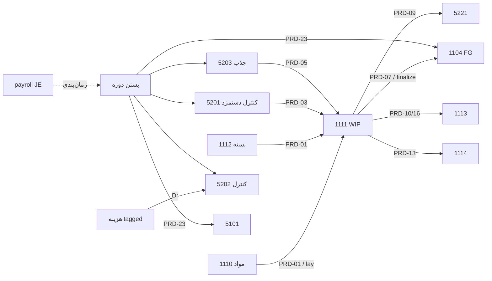

# تحقیق تولید — تنظیمات حرفه‌ای + ثبت‌های دقیق حسابداری

**وضعیت:** Research (pre-ADR جامع) — قبل از هر تغییر schema/UI گسترده  
**تاریخ:** ۱۴۰۵/۰۷/۱۸  
**منبع:** skill-top **full** + tap-erp-architecture + ECC (architect/planner) + متخصصان موازی ops→JE / settings / verify  
**Slack:** در workspace متصل هیچ پیام/کانالی برای «تولید / WIP / سربار / erp» یافت نشد — منبع حقیقت کد + `docs/Production/*` + ADRهای موجود است.

## هدف محصول

هر آیتم منوی **تولید** (اطلاعات پایه / عملیات / گزارشات) باید:

1. طبق قوانین خودش روی موجودی و دفتر کل اثر بگذارد (دوطرفه، اتمیک، قابل ابطال R13).
2. تنظیمات حرفه‌ای **per-entity** داشته باشد (مرکز هزینه، BOM، سفارش، برش، دوره) — نه فقط seed سراسری بدون UI.
3. وابستگی تک‌به‌تک با انبار (1110/1111/1104/1112…) و هزینه/حقوق (5201/5202) شفاف و قابل تطبیق باشد.

| لایه | محتوا | امروز |
|------|--------|--------|
| **A** اطلاعات پایه | BOM، نرخ سربار مراکز، دسترسی | قوی روی rates/BOM؛ پنل Production Settings **MISSING** |
| **B** عملیات | سفارش، لایه‌چینی، تابلو خط، برآورد، MRP، بستن دوره | موتور PRD + cutting موازی |
| **C** گزارشات | داشبورد، انحراف، سود ماهانه، برگه بها | خواندنی از GL/سفارش |
| **D** تنظیمات حرفه‌ای | defaults، گیت JE، انبارهای پیش‌فرض، آستانه انحراف، روش تسهیم | بیشتر seed بدون UI/API |

## ثابت‌های قفل‌شده (تغییر فقط با ADR جدید)

| ثابت | منبع | معنا |
|------|------|------|
| پول | ADR-001 | DB = ریال صحیح؛ `postToLedger` مرز تومان |
| ارزش‌گذاری | ADR-001 | میانگین موزون perpetual روی **header محصول**؛ رنگ×سایز تحلیلی |
| مصرف | ADR-001 | یک مالک مصرف per ماده/مرحله؛ lay و backflush دوباره‌مصرف نکنند |
| برش+PO | ADR-001 / F06 | pack متصل به سفارش = فقط qty WIP؛ بدون WIP→FG JE |
| حقوق | ADR-001 | payroll مالک بدهی پرسنل؛ تولید فقط جذب به کنترل |
| سربار جذب | ADR-002 | `نرخ × محرک × absorb٪`؛ بدون موتور IAS 2 خالص ثابت/متغیر در همین موج |
| ابطال | R13 | soft-void JE + reverse موجودی؛ حذف فیزیکی ممنوع |
| آفلاین | ADR-001 | قطعیت مالی روی مرکز؛ LWW برای JE/avg ممنوع |

**مرجع کاتالوگ رویداد:** `docs/Production/accounting-events.md` + کد زنده `server/lib/production/posting.js`.

---

## ۱) منو ↔ نقش حسابداری

| Nav | نقش | اثر qty/JE؟ |
|-----|-----|-------------|
| فرمول تولید (BOM) | استاندارد / routing | خیر (مرجع) |
| نرخ سربار مراکز | نرخ ازپیش‌تعیین + دستمزد مستقیم | خیر تا اجرا |
| دسترسی تولید | RBAC × مرکز هزینه | خیر |
| داشبورد / تابلو خط | نظارت | خیر |
| سفارش‌های تولید | Work Order + اجرای PRD | بله |
| لایه‌چینی / رسید محصول | مسیر برش پارچه | بله (JE موازی بدون تگ PRD) |
| برآورد سریع / MRP | برنامه‌ریزی | خیر (عمدی) |
| بستن دوره | کنترل ۵۲۰x + تسهیم انحراف | بله PRD-21…23 |
| ماتریس انحراف / سود ماهانه / برگه بها | گزارش | خیر |

---

## ۲) کاتالوگ PRD — تعریف‌شده vs فراخوان زنده

| PRD | در `posting.js` | `postEvent` زنده | مسیر جایگزین / شکاف |
|-----|-----------------|------------------|---------------------|
| 01 مواد | ✅ | engine / advanced | cutting lay: `postToLedger` بدون تگ PRD |
| 02 برگشت مواد | ✅ | engine | — |
| 03 جذب دستمزد | ✅ | engine / advanced | — |
| 04 دستمزد واقعی | ✅ | **خیر** | payroll → `5201`/`2104` با `sourceType=payroll` |
| 05 جذب سربار | ✅ | engine / advanced | — |
| 06 سربار واقعی | ✅ | **خیر** | هزینه tagged → Dr `5202` |
| 07 رسید FG | ✅ | engine / advanced | cutting pack standalone: بدون تگ PRD |
| 08 ضایعات عادی | فقط docs | بدون JE | درست (جذب در WIP) |
| 09 ضایعات غیرعادی | ✅ | engine / advanced / SC | cutting waste موازی |
| 10 ضایعات قابل فروش | ✅ | engine / advanced | — |
| 11/12 دوباره‌کاری | ✅ | **خیر** | فقط `qty_rework` تعادلی |
| 13/14 پیمانکار | ✅ | `subcontract.js` | بدون void جدا؛ فقط reverse مرحله |
| 16 محصول فرعی | ✅ | finalize advanced | کد: Dr `coa_scrap_inventory` (نه همیشه 1104 docs) |
| 17 تعدیل | ✅ | **خیر** | — |
| 20 انحراف مواد | docs | بدون JE | ADR-011 memo |
| 21/22/23 بستن | ✅ | `close.js` | 22 فقط حجم `5215`؛ **`5214` پست نمی‌شود** |
| 99 ابطال | نام | هرگز `postEvent(99)` | `reverseEvent` → `{type}_reversal` |

---

## ۳) ماتریس عملیات → موجودی → JE (خلاصه اجرایی)

| عملیات | موتور | Qty | بها | JE | Void/R13 | شکاف |
|--------|-------|-----|-----|-----|----------|------|
| ایجاد/به‌روز سفارش | `createOrder` | — | std BOM | — | cancel پیش از issue | — |
| آزادسازی | `release*` | رزرو | avg برای رزرو | — | آزادسازی رزرو | بدون JE تا issue/receipt |
| حواله مواد (variable) | `issueMaterialsVariable` / `issueStageMaterials` | − مواد | avg | **PRD-01** | reverse/purge | advanced issue: گیت ماه دوره **PARTIAL** |
| برگشت مواد | `postMaterialReturn` | + مواد | بهای حواله | **PRD-02** | همان | — |
| رسید fixed | `postReceiptFixed` | backflush −؛ FG + | avg + WIP_net | **01,03,05,09,10,07** | `reverseOrder` | preview بدون `absorb_pct` |
| رسید variable | `postReceiptVariable` | FG + | WIP قبلی | **03,05,09,10,07** | همان | نیاز issue قبلی |
| خروجی مرحله | `postStageCore` | مرحله‌ای | unit مرحله | 01/03/05/09/10 | `reverseStage` | — |
| نهایی‌سازی advanced | `finalizeAdvancedOrder` | FG +؛ scrap + | آخرین مرحله | **16,07** | purge زنجیره | هم‌ترازی pack+finalize |
| پیمانکار out/in | `subcontract.js` | — (ارزش) | unit WIP | **13,14,(09)** | reverse مرحله | بدون API void جدا |
| لایه‌چینی | `postCuttingLay` | − طاقه | بهای طاقه | موازی WIP←raw | void lay | بدون تگ PRD |
| pack برش +PO | `postCuttingPack` | + WIP WH | سهم lay | **بدون FG JE** | void pack | F06 ✅ |
| pack برش بدون PO | همان | + FG | WIP→FG | موازی PRD-07 | void pack | — |
| بستن دوره | `close.execute` | اختیاری avg bump | انحراف | **21,22,23** | reopen admin | precheck انتظار sourceTypeهایی که پست نمی‌شوند |
| legacy `production_runs` | `routes/production.js` | stock مستقیم | دستی | **بدون JE** | DELETE | گیت 409 وقتی advanced روشن |
| برآورد / MRP / گزارش | estimate/mrp/reports | — | — | — | — | درست برای planning |

جزئیات کامل‌تر در خروجی متخصص [Map prod ops to JE](02bab5c1-2391-40d7-b975-77a485ad225a).

---

## ۴) کلیدهای COA تولید (`schema.js` seed / `coa-map`)

| کلید | کد | نقش |
|------|-----|-----|
| `coa_raw_materials` | 1110 | مواد |
| `coa_wip` | 1111 | در جریان ساخت |
| `coa_packaging_materials` | 1112 | بسته‌بندی |
| `coa_finished_goods` | 1104 | محصول |
| `coa_scrap_inventory` | 1113 | ضایعات |
| `coa_subcontract_inventory` | 1114 | نزد پیمانکار |
| `coa_labor_control` | 5201 | کنترل دستمزد |
| `coa_overhead_control` | 5202 | کنترل سربار واقعی |
| `coa_overhead_applied` | 5203 | سربار جذب‌شده |
| `coa_var_material_*` | 5210/5211 | انحراف مواد (memo تا ADR خلاف) |
| `coa_var_labor_*` | 5212/5213 | انحراف دستمزد |
| `coa_var_oh_budget` | 5214 | انحراف بودجه — **پست زنده ندارد** |
| `coa_var_oh_volume` | 5215 | کم/بیش‌جذبی حجم |
| `coa_abnormal_waste` / `coa_rework_cost` | 5221/5222 | ضایعات/دوباره‌کاری |
| `coa_subcontract_fee` | 5230 | اجرت پیمانکار |

---

## ۵) تنظیمات حرفه‌ای — EXISTS / PARTIAL / MISSING

### ۵.۱ سراسری (`settings`)

| کلید | وضع | یادداشت |
|------|-----|---------|
| `module_production` | EXISTS | گیت منو |
| `production_legacy_runs_enabled` + overhead legacy | EXISTS | مسیر قدیمی |
| `cost_center_rates` + UI نرخ | EXISTS | ADR-002 / v334 |
| `production_wh_raw/fg/scrap/sub/dist_id` | PARTIAL | seed؛ بدون UI ادمین |
| `production_wh_wip_id` | PARTIAL | مصرف در cutting؛ seed ناقص |
| `production_auto_post_je` / `production_backflush_on_receipt` | MISSING | seed؛ gating خوانده نمی‌شود |
| `production_costing_method` | MISSING | runtime از inventory |
| `production_variance_*` / `normal_waste_default` | PARTIAL | close/waste می‌خوانند؛ بدون UI |
| `production_allow_negative_stock` | PARTIAL | تضاد با trigger انبار |
| `GET/PUT /production/config` کامل (docs) | MISSING | فقط overhead legacy |
| `overhead_allocation_rules` | MISSING | جدول بدون route |
| `coa_*` تولید در ALLOWED_KEYS ادمین | MISSING | فقط map/seed |

### ۵.۲ per-entity پیشنهادی (هدف)

| موجودیت | فیلدهای حرفه‌ای پیشنهادی | امروز |
|---------|--------------------------|--------|
| مرکز هزینه | driver، capacity، labor method، tafsili OH/LB، stage flag | ستون‌ها PARTIAL؛ UI کامل نیست |
| نرخ دوره | بودجه / نرخ / absorb / دستمزد جدا (ADR-002) | EXISTS پس از v334 |
| BOM | scrap٪، backflush، assignment عملیات، نسخه | EXISTS per-BOM؛ سیاست شرکتی MISSING |
| سفارش | analysis، WHها، `coa_wip_tafsili`، `manual_driver_qty` | فیلدها EXISTS؛ default شرکتی ضعیف |
| برش | WH raw/wip/fg، %ضایعات، الزام link-to-PO | عملیاتی EXISTS؛ policy UI MISSING |
| بستن دوره | method، threshold، payroll gate، reopen policy | workflow EXISTS؛ knobs UI PARTIAL |
| دسترسی | view/post per CC روی همه mutationها | UI EXISTS؛ enforce روی issue/cutting PARTIAL |

جزئیات: [Map prod settings matrix](6c1b4d02-3915-4cf3-a7ea-b75253841e71).

---

## ۶) تأیید Verify (۱۰ ادعا روی کد زنده)

| # | ادعا | نتیجه |
|---|------|--------|
| 1 | PRD-06 هرگز پست نمی‌شود | **STILL OPEN** |
| 2 | 5214 هرگز پست نمی‌شود | **STILL OPEN** |
| 3 | legacy بدون JE | **PARTIAL** (گیت نوشتن؛ تاریخچه مهاجرت نشده) |
| 4 | pack+PO double FG | **FIXED** (F06) |
| 5 | advanced بدون گیت ماه | **PARTIAL** (`assertPeriodOpen` روی stage/finalize؛ نه روی issue مرحله) |
| 6 | R13 شمارنده OH | **FIXED** (v334 `reverseAppliedOverheadCounters`) |
| 7 | preview/rollup بدون absorb٪ | **STILL OPEN** |
| 8 | packaging→1112 | **FIXED** در `ledger.js` (سند انبار قدیمی در این نقطه stale) |
| 9 | مواد بدون assignment → مرحله اول | **PARTIAL** |
| 10 | F01 بازنویسی WH از `products.stock` | **FIXED** |

منبع: [Verify prod ACC gaps](cf22c193-5890-41ef-97e4-ffe39e4d73f4).

---

## ۷) گراف وابستگی حسابداری

**Invariant هدف:** برای هر سفارش تکمیل‌شده و پس از بستن دوره:  
`مانده کنترل‌های 5201/5202/5203 ≈ ۰ (±۵ ریال)` و `WIP سفارش ≈ ۰` مگر سفارش باز؛  
`Δ ارزش زیردفتر مواد/FG typed = Δ GL همان حساب` پس از پست و پس از void.

---

## ۸) Research notes (خارجی) — ≤۳ مرجع

| Practice | کاربرد برای ترنم |
|----------|------------------|
| ERPNext Work Order + Stock Entry (Material Transfer / Manufacture) | جدا کردن انتقال به WIP از Manufacture؛ الگوی skip-transfer / backflush — هم‌تراز fixed vs variable |
| ERPNext Manufacturing Settings (default WIP WH، overproduction %) | پنل Production Settings گمشده |
| IAS 2 §§12–13 + ADR-002 فعلی | جذب بر ظرفیت نرمال؛ کم‌جذبی دوره؛ موتور خالص ثابت/متغیر موج بعد |

### مرجع مخازن

1. **frappe/erpnext** — Work Order / Job Card / Stock Entry manufacture — reuse: lifecycle و WIP WH.  
2. داخلی: `docs/Production/accounting-events.md` + ADR-001/002 — reuse: قالب PRD و مرز ریال.  
3. داخلی: `WAREHOUSE-ACCOUNTING-RESEARCH.md` + `PROD-OH-DRIVERS-*` — reuse: typed COA و محرک سربار.

---

## ۹) موج پیاده‌سازی پیشنهادی

### P0 — توقف drift تراز / سند (الزامی قبل از UI تنظیمات)

1. یکسان‌سازی تگ JE برش با کاتالوگ PRD (یا جدول نگاشت `cutting_*` → PRD) + capture/sync hygiene.  
2. گیت `assertPeriodOpen` روی `issueStageMaterials` و هر مسیر JE باقی‌مانده.  
3. هم‌ترازی docs/precheck بستن با واقعیت: PRD-04/06 vs payroll/expense (یا پست واقعی یا حذف انتظار).  
4. تست طلایی: سفارش fixed + variable_adv + lay→link→finalize + close — تراز آزمایشی و کنترل‌ها ≈۰.

### P1 — تنظیمات حرفه‌ای Production Settings

5. پنل ادمین: `production_wh_*` (از جمله WIP)، آستانه‌های انحراف/ضایعات، default `analysis_type`، گیت‌های JE/backflush خوانده‌شونده.  
6. تکمیل UI مرکز هزینه تولید (driver/stage/tafsili) + enforce دسترسی روی issue/cutting.  
7. Help داخل برنامه + CHANGE-LOG.

### P2 — رویدادهای ناقص کاتالوگ

8. تصمیم ADR: واقعی‌سازی PRD-06/04 یا به‌روزرسانی دائم docs/precheck.  
9. پست اختیاری `5214` بودجه vs فقط `5215` حجم.  
10. absorb٪ در preview/rollup؛ PRD-11/12 اگر محصول نیاز دارد.  
11. هم‌ترازی PRD-16 (1104 vs 1113) با docs.

### P3 — یکپارچگی انبار و گزارش تطبیق

12. وابستگی به موج انبار: typed COA روی رسید/خرید تا مواد ورودی تولید drift نکند.  
13. گزارش تطبیق WIP per سفارش ↔ GL 1111؛ کنترل ۵۲۰x ماه.  
14. ADR نهایی «PROD-ACC-ADR-003» پس از قفل تصمیم‌های باز.

---

## ۱۰) تصمیم‌های باز (قبل از کد)

1. آیا سربار واقعی باید حتماً `postEvent(PRD-06)` شود یا کافی است expense→5202 + به‌روز docs؟  
2. آیا دستمزد واقعی باید PRD-04 جدا از payroll باشد یا payroll کافی است؟  
3. آیا JEهای cutting باید به PRD-01/07/09 مهاجرت کنند یا `sourceType` موازی رسمی بماند؟  
4. آیا `5214` در بستن دوره لازم است یا فقط حجم (`5215`)؟  
5. آیا محصول فرعی همیشه NRV به 1113 است یا گاهی 1104؟  
6. آیا پنل Production Settings قبل از P0 تگ‌گذاری برش مجاز است؟ (پیشنهاد: خیر)

---

## ۱۱) فایل‌های کلیدی implementer

| حوزه | مسیر |
|------|------|
| کاتالوگ JE | `server/lib/production/posting.js` |
| اجرا ساده/پیشرفته | `engine.js`, `engine-advanced.js` |
| سربار / بها | `overhead.js`, `costing.js`, `labor.js` |
| برش | `cutting.js`, `routes/production-cutting.js` |
| بستن | `close.js`, `routes/production-close.js` |
| اسکیما / seed | `lib/production/schema.js` |
| UI منو | `public/acc-nav.js`, `public/app.js` |
| مستند رویداد | `docs/Production/accounting-events.md` |
| ADRهای قبلی | `PROD-ACC-ADR-001`, `PROD-OH-DRIVERS-ADR-002`, `PROD-ACC-PA00` |
| تست‌ها | `test-overhead-*`, `test-production-*`, `test-prod-acc-*`, close suites |

## Skills / plugins استفاده‌شده

- skill-top (full) · ECC AGENTS (architect/planner برای موج بعد) · tap-erp-architecture  
- slack-search / slack-api — بدون نتیجه در workspace فعلی  
- متخصصان موازی: ops→JE · settings matrix · verify gaps
